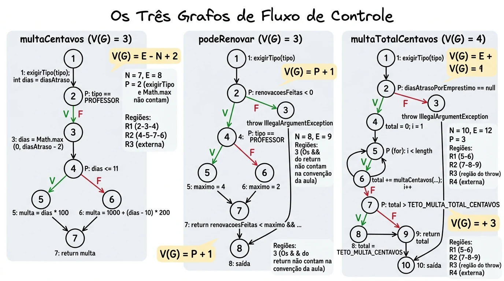
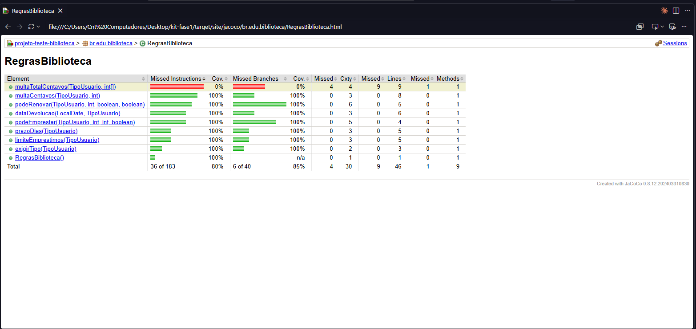
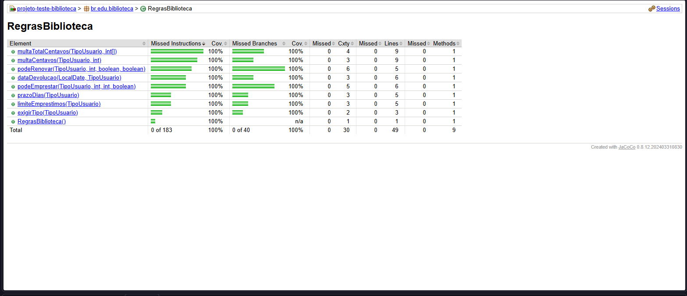

## 4. Conjunto-base e um teste por caminho
 
O resultado esperado vem **sempre da especificação**. A coluna "Obtido" mostra o que o código devolve, e um teste que falha revelou um defeito (ver `DEFEITOS.md`).
 
### 4.1 `multaCentavos` (V(G) = 3, 3 caminhos)
 
| Caminho | Entrada | Esperado (spec) | Obtido | Teste |
|---|---|---|---|---|
| 1-2-4-5-7 | `ALUNO`, 5 dias | 500 | 500 | `MultaCentavosCaminhosTest.caminho1_alunoAteDezDias` |
| 1-2-4-6-7 | `ALUNO`, 12 dias | 1400 | 1400 | `MultaCentavosCaminhosTest.caminho2_alunoAcimaDeDezDias` |
| 1-2-3-4-5-7 | `PROFESSOR`, 5 dias | 200 (carência de 3 dias, 2 cobrados) | 300 (falha, K5) | `MultaCentavosCaminhosTest.caminho3_professorComCarencia` |
 
### 4.2 `podeRenovar` (V(G) = 3, 3 caminhos)
 
| Caminho | Entrada | Esperado (spec) | Obtido | Teste |
|---|---|---|---|---|
| 1-2-4-6-7-8 | `ALUNO`, 0 renovações, sem reserva, sem atraso | `true` | `true` | `PodeRenovarCaminhosTest.caminho1_alunoSemRestricoes` |
| 1-2-4-5-7-8 | `PROFESSOR`, 3 renovações, sem reserva, sem atraso | `false` (professor renova até 3 vezes) | `true` (falha, K10) | `PodeRenovarCaminhosTest.caminho2_professorComTresRenovacoes` |
| 1-2-3-8 | `ALUNO`, -1 renovações, sem reserva, sem atraso | `IllegalArgumentException` | `IllegalArgumentException` | `PodeRenovarCaminhosTest.caminho3_renovacoesNegativasLancamExcecao` |
 
### 4.3 `multaTotalCentavos` (V(G) = 4, 4 caminhos)
 
| Caminho | Entrada | Esperado (spec) | Obtido | Teste |
|---|---|---|---|---|
| 1-2-4-5-7-9-10 | `ALUNO`, `{}` | 0 | 0 | `MultaTotalCentavosTest.caminho1_listaVazia` |
| 1-2-3-10 | `ALUNO`, `null` | `IllegalArgumentException` | `IllegalArgumentException` | `MultaTotalCentavosTest.caminho2_listaNulaLancaExcecao` |
| 1-2-4-5-6-5-7-9-10 | `ALUNO`, `{5, 12}` | 1900 (500 + 1400) | 1400 (falha, K12) | `MultaTotalCentavosTest.caminho3_somaDosEmprestimos` |
| 1-2-4-5-6-5-7-8-9-10 | `ALUNO`, `{25, 25, 25, 25}` | 10000 (4 × 4000 = 16000, limitado a R$ 100,00) | 5000 (falha, K13) | `MultaTotalCentavosTest.caminho4_totalLimitadoAoTeto` |
 
No caminho 4, cada multa de 25 dias vale 4000, abaixo do teto individual de R$ 50,00, então só o teto total interfere. São 4 empréstimos porque o código ignora o primeiro (K12): com 3 elementos, o `if` do teto não seria executado.
 
Testes extras (além do conjunto-base) em `MultaTotalCentavosTest`: `listaComUmElemento` (`{7}`, esperado 700), `elementoNegativoLancaExcecao` (`{5, -1}`) e `tipoNuloLancaExcecao`.
 
## 5. Relação com os defeitos
 
Os defeitos encontrados só na fase 2 (K12 e K13, em `multaTotalCentavos`) estão marcados em `DEFEITOS.md`. Cobertura de 100% não garante ausência de defeitos: `multaCentavos`, `podeEmprestar` e `podeRenovar` já tinham 100% de ramos e continuam com defeitos, como operador trocado (`<=` no lugar de `<`), constante errada e código ausente (teto e validações). Um teste de caminho não encontra código que falta, e só a comparação com a especificação revela esses casos.